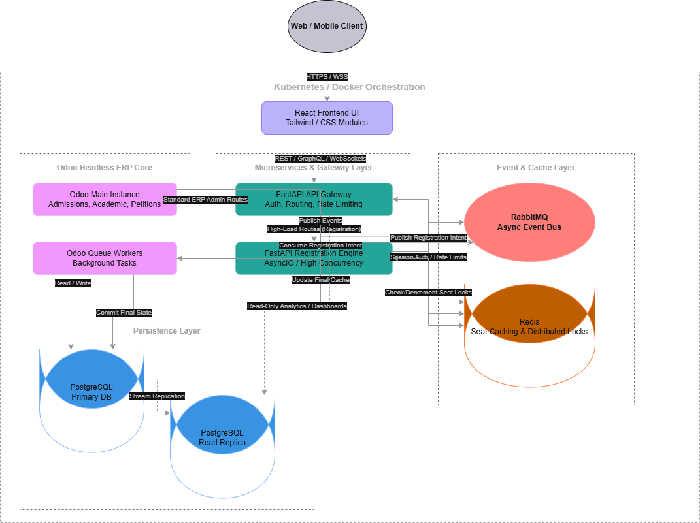

# Bookmark Academic ERP Architecture Documentation

## 1. Executive Summary
The Bookmark Academic ERP represents a paradigm shift from traditional, monolithic enterprise systems to a modern, highly scalable, and decoupled microservices architecture. By transitioning away from native Odoo XML dashboards and tightly coupled backend logic, the platform embraces a headless ERP model. This architecture leverages a React-based frontend for an optimized, dynamic user experience, an API Gateway for centralized routing and security, and RabbitMQ for robust asynchronous messaging. Containerized via Docker and orchestrated with Kubernetes, the Bookmark Academic ERP is designed to ensure high availability, seamless scalability during peak academic cycles (e.g., registration periods), and distinct separation of concerns across the presentation, business logic, and data layers.

## 2. Architecture Overview
The platform's architecture is logically divided into several decoupled layers, ensuring modularity and independent scalability.

### Presentation Layer
*   **Technology Stack:** React, Tailwind CSS, CSS Modules.
*   **Functionality:** Completely replaces native Odoo UI/XML views. The React frontend provides a responsive, single-page application (SPA) experience. It consumes RESTful APIs exposed by the gateway, managing state independently of the backend.
*   **Decoupled Authentication:** Implements token-based authentication (JWT). It stores secure tokens client-side and passes them via authorization headers, entirely decoupling session management from Odoo's internal monolithic session handling.

### API Gateway
*   **Technology Stack:** FastAPI (Python).
*   **Functionality:** Acts as the single entry point for all client requests.
*   **Routing & Security:** Routes incoming requests to the appropriate underlying microservices or Odoo endpoints. It handles rate limiting to mitigate DDoS attacks and manages JWT validation and authentication *before* requests ever reach the core ERP, acting as a crucial security perimeter.

### Core ERP Layer
*   **Technology Stack:** Headless Odoo (Python).
*   **Functionality:** Serves as the primary business logic engine and backend system of record.
*   **Custom Modules:** Modules such as `edu_mang_admission`, `edu_mang_petition`, and `custom_registration` have been heavily refactored. Instead of rendering traditional XML views, they expose REST APIs (via custom controllers) that return JSON data, adhering strictly to a headless architecture.

### Message Broker (RabbitMQ)
*   **Technology Stack:** RabbitMQ.
*   **Functionality:** Facilitates asynchronous messaging and microservice communication.
*   **Purpose:** RabbitMQ is introduced to decouple heavy, resource-intensive tasks from the synchronous HTTP request-response cycle. This includes handling complex academic prerequisite calculations, processing OCR for uploaded documents, and dispatching bulk notification emails. By offloading these tasks to background workers, the API Gateway and ERP Layer remain responsive.

### Data Layer
*   **Technology Stack:** PostgreSQL.
*   **Functionality:** Provides robust, ACID-compliant relational data storage. Schema isolation and database tuning are implemented to support the high-throughput requirements of the decoupled ERP modules.

## 3. Asynchronous Workflows (RabbitMQ Use Cases)
RabbitMQ is critical for maintaining system performance under load. Below are two detailed use cases illustrating the asynchronous flow.

### Use Case 1: Student Petition Submission
When a student submits an academic petition, the process involves multiple heavy operations (e.g., faculty routing, document processing, and notifications) that should not block the user interface.
1.  **UI Interaction:** The student submits the petition form via the React UI.
2.  **API Gateway:** The gateway validates the JWT, applies rate limits, and forwards the payload.
3.  **Queue Dispatch:** Instead of processing the petition synchronously, the gateway (or an Odoo lightweight controller) publishes a `petition.submitted` message to a RabbitMQ exchange and immediately returns a `202 Accepted` response to the client.
4.  **Worker Processing:** An asynchronous background worker consumes the message, interacting with the Odoo `edu_mang_petition` module to write the record to PostgreSQL, evaluate complex routing rules, and trigger the Notification Service.
5.  **Completion:** The student receives an asynchronous notification (e.g., email or WebSocket update) once the petition is fully logged and routed.

### Use Case 2: Registration Capacity Checks
During peak course registration periods, database locks caused by highly concurrent transactions can severely degrade performance.
1.  **High-Concurrency Queuing:** Students hitting "Register" concurrently send requests via the API Gateway.
2.  **Message Broker:** The API Gateway publishes `registration.attempt` events to a dedicated, high-priority RabbitMQ queue.
3.  **Sequential Processing:** Background workers consume these messages sequentially (or with tightly controlled concurrency). They interface with the `custom_registration` module to perform complex prerequisite checks and capacity validations against the Data Layer.
4.  **Database Protection:** By queuing the requests, the system prevents database locking and race conditions (e.g., over-enrollment), ensuring transactional integrity without locking out other platform users.
5.  **Status Update:** The result of the registration attempt is pushed back to the client UI asynchronously.

## 4. Deployment & DevOps Strategy
The deployment infrastructure is designed for fault tolerance and dynamic scaling.

### Containerization Strategy (Docker)
The entire platform is containerized to ensure consistency across development, staging, and production environments:
*   **React Frontend:** Served via an Nginx container, optimized for static file delivery.
*   **API Gateway:** Containerized FastAPI application running via Uvicorn/Gunicorn.
*   **Odoo Instances:** Stateless Odoo application containers, allowing horizontal scaling independent of the database.
*   **Infrastructure:** RabbitMQ and PostgreSQL are containerized with persistent volume claims to prevent data loss.

### Orchestration Strategy (Kubernetes)
Kubernetes (K8s) is utilized to orchestrate the containerized microservices, ensuring high availability, especially during peak university registration periods:
*   **Pods:** Each microservice (Gateway, Odoo instances, React Nginx, RabbitMQ Workers) runs in isolated Pods.
*   **Services:** Internal K8s Services enable stable networking and load balancing between the API Gateway, RabbitMQ, and the headless Odoo instances.
*   **Ingress Controller:** Manages external access, routing HTTPS traffic to the React frontend or the API Gateway appropriately.
*   **Auto-scaling:** Horizontal Pod Autoscalers (HPA) dynamically spin up additional API Gateway and Odoo pods based on CPU/Memory metrics during registration spikes, ensuring the platform remains responsive under severe load.
