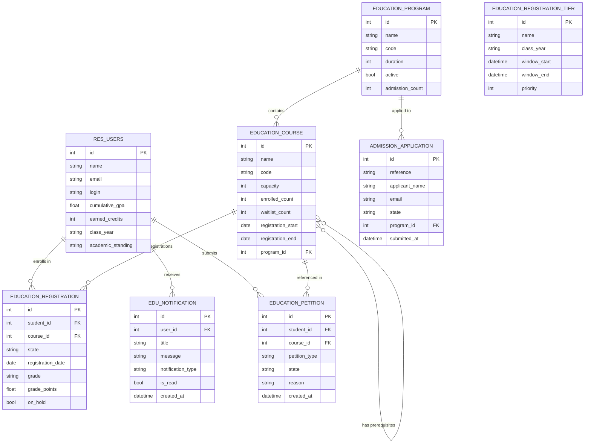

# Database Entity-Relationship Diagram

Bookmark Academic ERP uses Odoo's PostgreSQL schema extended by three custom modules:
`edu_mang_academic`, `edu_mang_notification`, and `edu_mang_waitlist`.

## Core Entity Relationships

## Redis Data Structures

| Key Pattern | Type | Purpose |
|---|---|---|
| `token:blocklist:{jti}` | String (TTL) | Revoked JWT tokens |
| `active_session:{uid}:{jti}` | String (TTL) | Active session tracking for concurrent user count |
| `rate_limit:*` | String | SlowAPI rate limit counters |

## Custom Module Summary

| Module | Models Added | Purpose |
|---|---|---|
| `edu_mang_academic` | grade/grade_points on Registration; GPA/credits/standing on Users; Registration Tier | Grades, GPA computation, seniority-based registration windows, prerequisite enforcement |
| `edu_mang_notification` | edu.notification | In-app notifications on admission/registration/petition events |
| `edu_mang_waitlist` | (extends education.registration) | FIFO waitlist promotion, auto-notification on promotion |
