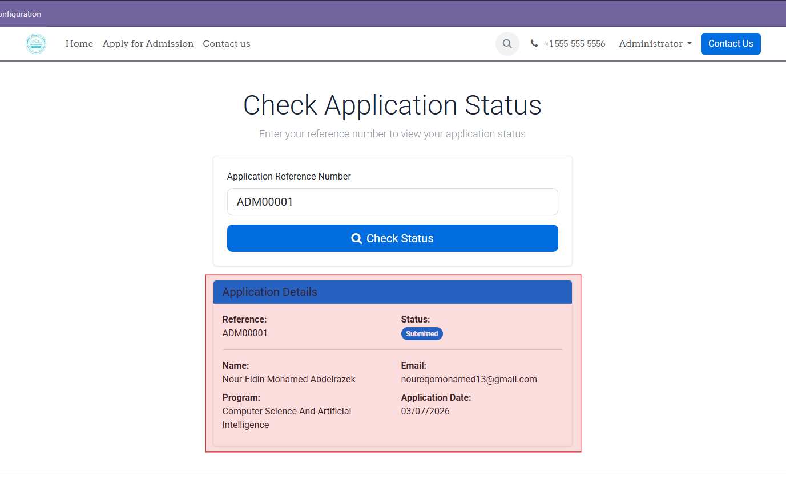
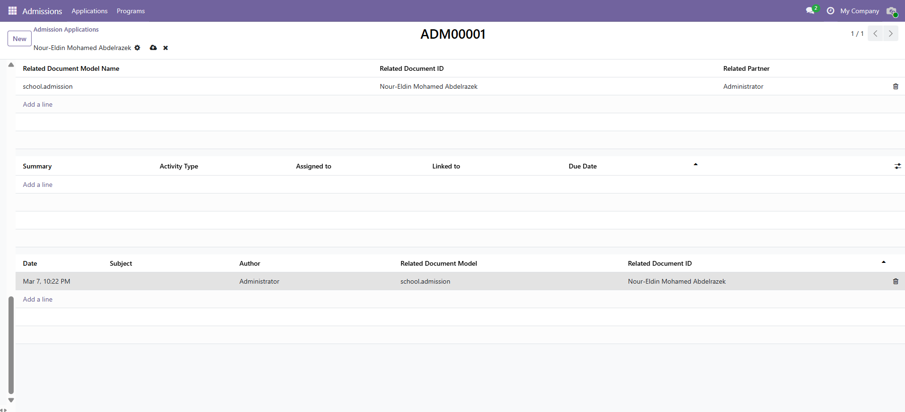

# Bookmark Academic ERP

A production-grade Educational ERP system built on Odoo 19 with a fully decoupled React frontend, FastAPI API gateway, and three integrated AI/ML microservices.

---

## Team Members

| Name | ID | Role |
|---|---|---|
| Noureqo (Nour) | — | Team Lead, Backend & API Gateway |
| ZiadMAlsawy | — | Infrastructure, Kubernetes & DevOps |
| NourEldin Mohamed | — | Frontend & Odoo Addons |
| RaneeMousAdam (Raneem) | — | AI/ML Services (Grade Predictor, Student Performance) |
| Ahmed Abouelela | — | OCR Service & Integration |

**Supervisor:** Dr. Doaa Shawky (Main) · Dr. Yousry Abdul Azeem (Joint)

---

## Problem Statement

Egyptian universities rely on fragmented, manual processes for admissions, course registration, grading, and student advising. Existing systems (including standard Odoo) do not provide a modern student-facing experience, AI-powered insights, or the scalability needed for large institutions. This project replaces the Odoo monolithic frontend with a decoupled microservices architecture that integrates real AI predictions and an LLM-powered academic advisor.

---

## System Architecture

```
React Frontend (5173)
        │
        ▼
FastAPI API Gateway (8000)  ──► Redis (token blocklist, sessions)
        │
        ├──► Odoo ERP Backend (8081) ──► PostgreSQL (5432)
        │
        ├──► OCR Microservice (5000)          [YOLOv8 + Tesseract, 93% accuracy]
        ├──► Grade Predictor (8000)            [XGBoost + Isotonic Calibration]
        ├──► Student Performance (5002)        [Triple XGBoost + CQR, R²=0.767]
        └──► RAG Academic Chatbot (8001)       [LLM Agent + RabbitMQ + Odoo tools]

Observability: Prometheus (9090) + Grafana (3000)
Orchestration: Kubernetes (kind/minikube) + Docker Compose
```

Full architecture diagram: [Docs/ARC/platform_architecture.drawio.png](Docs/ARC/platform_architecture.drawio.png)

---

## Features

### Student Portal
- Course catalog with prerequisite enforcement and real-time seat counts
- Online course registration with seniority-based tier windows
- Waitlist with automatic FIFO promotion (cron + event-driven)
- Live GPA, per-term transcript, and academic standing
- Petition submission and status tracking
- AI Grade Predictor — predicts grade distribution for enrolled courses
- AI Student Performance — predicts performance trend with 90% confidence intervals

### Admissions
- Online admission form with OCR auto-fill from National ID card images
- Application status tracking via reference number
- Full workflow: Draft → Submitted → Under Review → Accepted / Rejected

### Faculty
- Course roster management
- Petition review and approval
- Grade submission

### Registrar
- Dashboard: enrolled counts, open seats, capacity utilization, active concurrent users
- Course prerequisite management
- Registration tier/window configuration

### Admin
- User management with real role resolution (Student / Faculty / Registrar / Admin)
- Admissions pipeline with stage drag-and-drop
- Institutional ruleset configuration
- Prometheus + Grafana monitoring

### AI Academic Chatbot
- LLM agent with tools: course lookup, grade retrieval, petition status, schedule queries
- Asynchronous job queue via RabbitMQ
- Context-aware responses grounded in live Odoo data

---

## Technologies

| Layer | Technology |
|---|---|
| Frontend | React 18, Vite, React Router, Tailwind CSS, CSS Modules |
| API Gateway | FastAPI, NGINX, SlowAPI (rate limiting), JWT (HS256), Redis |
| Backend ERP | Odoo 19.0, Python 3.12, PostgreSQL 15 |
| AI / ML | XGBoost, scikit-learn, CQR, YOLOv8, EasyOCR, Tesseract, MLflow, DVC |
| LLM | OpenRouter API, RabbitMQ (async jobs) |
| Containerization | Docker, Docker Compose |
| Orchestration | Kubernetes (kind / minikube), Helm-compatible manifests |
| Observability | Prometheus, Grafana, structured JSON logging |
| CI/CD | GitHub Actions (4 workflows: unit, integration, MLflow tracking, testing) |
| Testing | pytest, pytest-cov, FastAPI TestClient, Odoo test runner |

---

## Quick Start

### Prerequisites
- Python 3.12, Node.js 20+, Docker Desktop, Git

### 1. Clone and configure environment
```bash
git clone https://github.com/Noureqo1/Odoo_Educational_ERP_System.git
cd Odoo_Educational_ERP_System
cp .env.example .env
# Edit .env with your values (JWT_SECRET_KEY, OPENROUTER_API_KEY, etc.)
```

### 2. Install Python dependencies
```bash
python -m venv venv
# Windows:
venv\Scripts\pip install -r api_gateway/fastapi_app/requirements.txt
# Linux/macOS:
venv/bin/pip install -r api_gateway/fastapi_app/requirements.txt
```

### 3. Start the API Gateway and services (Docker)
```bash
cd api_gateway
docker-compose up -d --build
cd ..
```

### 4. Start Odoo backend
```bash
# Windows:
venv\Scripts\python.exe odoo\odoo-bin -c config\odoo.conf
# Linux/macOS:
venv/bin/python odoo/odoo-bin -c config/odoo.conf
```

### 5. Install custom Odoo modules (first run only)
```bash
venv\Scripts\python.exe odoo\odoo-bin -c config\odoo.conf \
  -i edu_mang_notification,edu_mang_academic,edu_mang_waitlist \
  -d edu_demo_new --stop-after-init
```

### 6. Start the React frontend
```bash
cd bookmark-frontend
npm install
npm run dev
# App available at http://localhost:5173
```

---

## Deployment (Kubernetes)

```bash
# Create local cluster
make k8s-create-cluster

# Build and load images
make k8s-build-images
make k8s-load-images

# Deploy all services
make k8s-deploy

# Check status
make k8s-status

# Forward ports
make k8s-port-forward
```

Full Kubernetes documentation: [k8s/README.md](k8s/README.md)

---

## Environment Variables

Copy [`.env.example`](.env.example) to `.env` and fill in:

| Variable | Description |
|---|---|
| `JWT_SECRET_KEY` | Min 32-char secret for JWT signing |
| `OPENROUTER_API_KEY` | API key for the RAG chatbot LLM |
| `POSTGRES_PASSWORD` | PostgreSQL password |
| `REDIS_PASSWORD` | Redis password |
| `ODOO_PASSWORD` | Odoo admin password |

Never commit the `.env` file. See [api_gateway/.env.example](api_gateway/.env.example) for gateway-specific variables.

---

## API Documentation

The FastAPI gateway exposes interactive API docs automatically:

- Swagger UI: `http://localhost:8000/docs`
- ReDoc: `http://localhost:8000/redoc`

Key endpoint groups:

| Prefix | Description |
|---|---|
| `POST /api/v1/auth/login` | JWT login (returns access + refresh tokens) |
| `GET /api/v1/student/dashboard` | Student dashboard with live GPA |
| `GET /api/v1/student/grades` | Per-term transcript |
| `GET /api/v1/registration/courses` | Course catalog with prerequisites |
| `GET /api/v1/registrar/dashboard` | Registrar stats + active concurrent users |
| `GET /api/v1/admin/admissions/pipeline` | Kanban admissions pipeline |
| `POST /api/v1/ocr/process` | National ID OCR extraction |
| `POST /api/v1/chatbot/message` | Academic chatbot (async via RabbitMQ) |

---

## AI/ML Services

### Grade Predictor (port 8000)
Predicts grade distribution (A/B/C/D/F) for a student's enrolled courses.

- Model: XGBClassifier with **isotonic calibration**
- Selection criterion: maximize `Exact Accuracy − ECE (calibration error)`
- Final metrics: Accuracy = 0.511, ECE = 0.070
- A/B comparison: [notebooks/Model_AB_Testing.pdf](notebooks/Model_AB_Testing.pdf)

### Student Performance Predictor (port 5002)
Predicts performance trend with uncertainty quantification.

- Architecture: **Triple XGBoost + Conformal Quantile Regression (CQR)**
- Metrics: R² = 0.767, ROC-AUC = 0.952, Brier = 0.083, CQR coverage = 91%

### OCR Service (port 5000)
Extracts student data from National ID card images.

- Pipeline: **YOLOv8** (field detection) + **Tesseract** (text extraction)
- Accuracy: 93% (vs. EasyOCR 71%, Gemini Vision 89%)
- Fallback: Mistral Vision API for low-confidence cases

---

## Test Credentials

Database: `edu_demo_new`

| Role | Email | Password |
|---|---|---|
| Admin | `admin@test.com` | `admin123` |
| Student | `student@test.com` | `student123` |
| Officer | `officer@test.com` | `officer123` |

---

## Testing

```bash
# Install test dependencies
make test-install

# Run all tests with coverage
make test-cov

# Run unit tests only
make test-cov-unit

# Run integration tests only
make test-cov-integration

# Run Odoo module tests
make test-admission
```

Test suite: 75+ test cases across unit, integration, and security layers.
CI: 4 GitHub Actions workflows run on every push and PR.

---

## Screenshots

### Admission Portal




### Backend Administration



### Services Health


---

## Project Structure

```
.
├── bookmark-frontend/          React 18 SPA
├── api_gateway/                FastAPI gateway + Docker Compose
│   └── fastapi_app/routers/    12 endpoint router modules
├── addons/
│   └── edu_mangment/           Custom Odoo modules
│       ├── edu_mang_notification/
│       ├── edu_mang_academic/
│       └── edu_mang_waitlist/
├── services/
│   ├── ocr/                    OCR microservice (YOLOv8 + Tesseract)
│   ├── grade_predictor_service/ Grade prediction (XGBoost)
│   ├── student_performance_service/ Performance prediction (CQR)
│   └── RAG-Chatbot/            LLM academic advisor
├── k8s/                        Kubernetes manifests
├── Tests/                      pytest test suite
├── Docs/                       Architecture, ADRs, workflows, RBAC
├── notebooks/                  AI model training notebooks + A/B report
└── .github/workflows/          CI/CD pipelines
```

---

## Documentation

- [Architecture Overview](Docs/ARC/Bookmark_Academic_ERP_Architecture.md)
- [Architecture Diagram](Docs/ARC/platform_architecture.drawio.png)
- [Kubernetes Deployment Guide](k8s/README.md)
- [AI Model A/B Testing Report](notebooks/Model_AB_Testing.pdf)
- [User Story Workflows](Docs/Workflows/)
- [Architecture Decision Records](Docs/ADR/)
- [RBAC Design](Docs/RBAC/)

---

## License

This project is submitted as a graduation project at [University Name]. All rights reserved by the project team.
