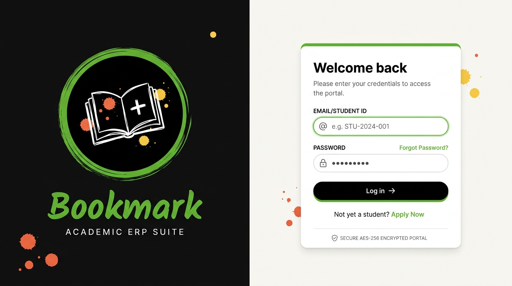
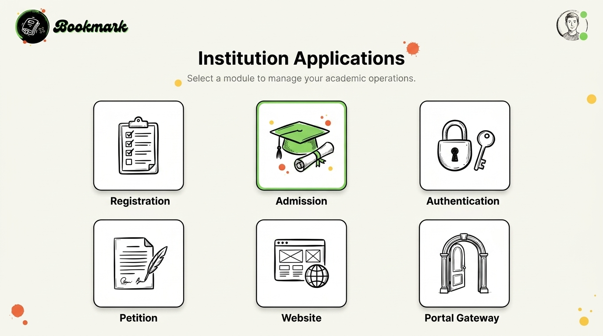
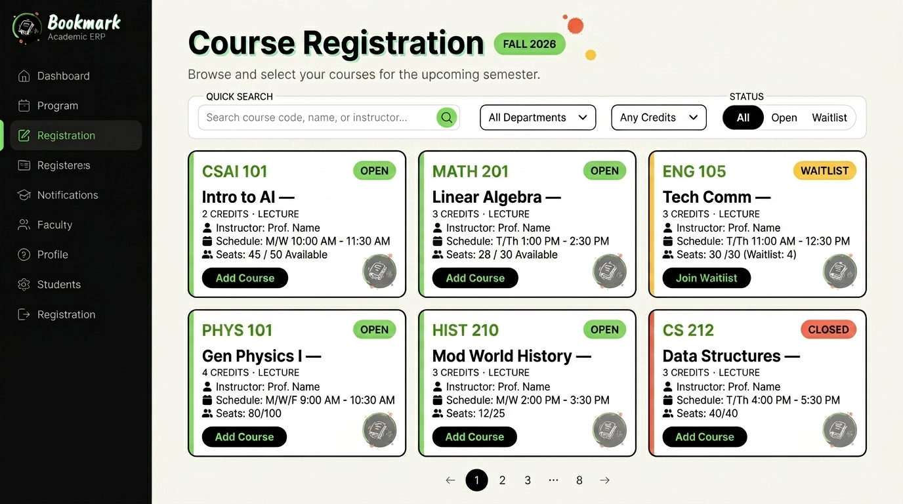
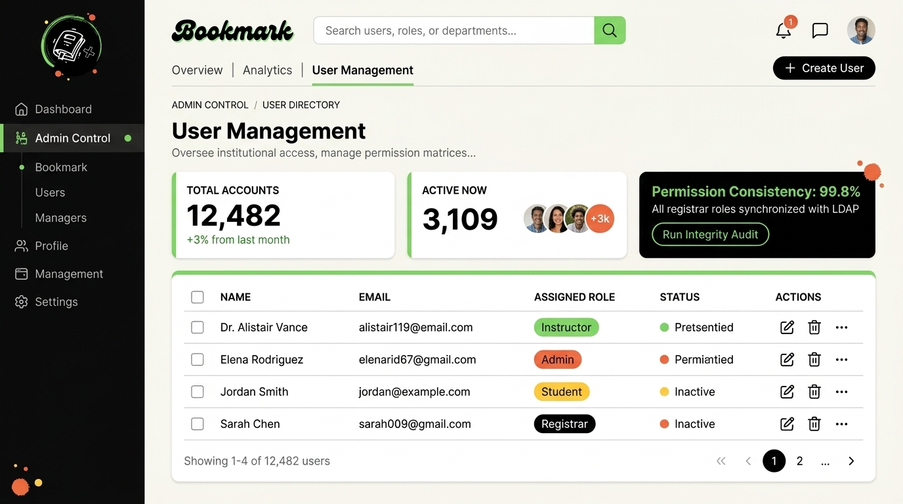

<div align="center">


# Bookmark Academic ERP Suite

**A modern, decoupled, microservices-based Educational Resource Planning platform.**

Replacing the monolithic Odoo frontend with a headless architecture: a React Single-Page Application, a FastAPI API Gateway, an Odoo 19.0 core, and a suite of AI & async microservices — all containerized with Docker and orchestrated with Kubernetes.

</div>

---

## 👥 Team Members

| Name | Student ID | Program |
| --- | --- | --- |
| Ahmed Mohamed | 202202070 | DSAI |
| Nour Eldin Mohamed | 202201310 | SWD |
| Raneem Mousa | 202200389 | DSAI |
| Ziad Moutaz | 202201252 | DSAI |

### Supervisor
**Prof. Dr. Doaa Shawky**

---

## ❓ Problem Statement

Traditional university management runs on monolithic ERP systems (such as native Odoo) where the UI, business logic, and data are tightly coupled. This creates real pain for an academic institution:

- **Poor user experience** — server-rendered XML views are slow, dated, and hard to tailor to distinct academic roles (Student, Faculty, Advisor, Department Chair, Registrar, Admission Officer, Admin).
- **Scalability bottlenecks** — during peak registration periods, concurrent enrollment requests cause database locks, race conditions, and over-enrollment.
- **Rigid, blocking workflows** — heavy operations (document OCR, bulk notifications, petition routing) run synchronously and freeze the request/response cycle.
- **Limited intelligence** — no native support for AI-assisted advising, grade prediction, or automated document verification.

**Bookmark Academic ERP** solves this by decoupling the system into independently scalable layers, exposing the Odoo core as a headless JSON/REST backend, offloading heavy work to asynchronous workers via RabbitMQ, and layering in AI microservices — delivering a fast, responsive, and intelligent academic management experience.

---

## ✨ Features

- **Headless Odoo Core** — standard XML views are replaced by high-performance JSON-RPC / REST endpoints, fully decoupling the frontend from the backend.
- **Role-Based Access Control (RBAC)** — canonical roles for Student, Faculty, Advisor, Department Chair, Registrar, Admission Officer, Student Affairs, and System Administrator, enforced at the gateway.
- **Admissions Pipeline** — Kanban-style applicant pipeline with stage transitions, document verification, and OCR-based metadata extraction.
- **Academic Petitions** — multi-tiered submission, routing, and review queues for Faculty, Chairs, and Registrars; decisions persist end-to-end.
- **Smart Course Registration** — real-time catalog, capacity utilization, prerequisite enforcement, and seniority-based registration windows (academic tiers).
- **Waitlist Auto-Promotion** — FIFO promotion when seats open, with cron-based safety net and live notifications.
- **Real GPA, Grades & Transcripts** — cumulative GPA, earned credits, class year, and academic standing computed from posted grades; printable transcripts and CSV exports.
- **Concurrent User Tracking** — Redis tracks active sessions (`uid` + `jti`) for real-time traffic monitoring on the Registrar dashboard.
- **Asynchronous Messaging** — RabbitMQ decouples notifications, admission emails, waitlist promotions, and grade alerts from the request cycle.
- **AI Services** — RAG-Chatbot academic agent, OCR document processing, student grade prediction, and student performance analytics.
- **Notifications Hub** — workflow-driven notifications on petition, registration, and admission events.
- **Observability** — Prometheus metrics and Grafana dashboards across the stack.

---

## 🏗 System Architecture

The platform is divided into loosely coupled, independently scalable layers.


| Layer | Technology | Responsibility |
| --- | --- | --- |
| **Presentation** | React, Vite, React Router, Tailwind CSS, CSS Modules | Headless SPA replacing native Odoo UI; manages state, JWT storage, async data fetching. |
| **API Gateway** | FastAPI (Python), NGINX | Single entry point; JWT validation, RBAC, rate limiting, SSL termination, microservice orchestration, Redis session tracking. |
| **Core ERP** | Headless Odoo 19.0 (Python) | Business logic — admissions, petitions, enrollments, grades, waitlists — exposed via custom REST/JSON-RPC controllers. |
| **Async & AI** | RabbitMQ, Python workers, Flask OCR, RAG-Chatbot, ML services | Background processing of OCR, notifications, registration attempts, grade prediction, and chatbot queries. |
| **Data** | PostgreSQL | ACID-compliant relational persistence for all ERP modules. |

### Asynchronous flow (example)
During peak registration, the gateway publishes `registration.attempt` events to RabbitMQ. Background workers consume them sequentially, run prerequisite/capacity checks against the data layer, and push results back to the UI — preventing DB locks and over-enrollment while keeping the platform responsive.

> Detailed architecture documentation lives in [`Docs/ARC/Bookmark_Academic_ERP_Architecture.md`](Docs/ARC/Bookmark_Academic_ERP_Architecture.md) and Architecture Decision Records in [`Docs/ADR/`](Docs/ADR/).

---

## 🛠 Technologies Used

- **Frontend:** React, Vite, React Router, Tailwind CSS, CSS Modules
- **Backend / API Gateway:** FastAPI (Python), NGINX, `httpx`, JWT auth
- **Core ERP:** Odoo 19.0 (custom addons under `addons/edu_mangment/` and `addons/open_edu_cat/`)
- **Database:** PostgreSQL
- **Caching / Sessions:** Redis
- **Messaging:** RabbitMQ
- **AI / ML:** RAG-Chatbot (academic agent), OCR microservice (Tesseract / Flask), grade prediction & student performance services (scikit-learn / Python ML)
- **Containerization & Orchestration:** Docker, Docker Compose, Kubernetes (Kind / Minikube)
- **Infrastructure as Code:** Terraform (modular — networking, compute, storage, firewall, secrets, DNS)
- **Observability:** Prometheus, Grafana
- **Build / Automation:** GNU Make (`Makefile`)

---

## ⚙️ Setup Instructions

### Prerequisites
- Docker & Docker Compose
- Python 3.10+ (for the local Odoo backend)
- Node.js 18+ (for the frontend)
- GNU Make (optional, but recommended — wraps all common commands)

### 1. Clone the repository
```bash
git clone https://github.com/Noureqo1/Odoo_Educational_ERP_System.git
cd Odoo_Educational_ERP_System
```

### 2. Install backend dependencies
```bash
make install            # installs Odoo Python requirements into venv
```

### 3. Start the API Gateway & infrastructure (Docker)
```bash
make gateway-up         # FastAPI, NGINX, RabbitMQ, Redis, Prometheus, Grafana, OCR
```

### 4. Start the headless Odoo backend
```bash
make run                # starts gateway + frontend + Odoo (or run Odoo directly):
# venv\Scripts\python.exe odoo\odoo-bin -c config\odoo.conf
```

### 5. Start the React frontend
```bash
cd bookmark-frontend
npm install
npm run dev
```

> **Custom modules:** on first run install the educational modules once, then update as needed:
> ```bash
> venv\Scripts\python.exe odoo\odoo-bin -c config\odoo.conf \
>   -i edu_mang_notification,edu_mang_academic,edu_mang_waitlist,edu_mang_support,edu_mang_audit \
>   -d edu_demo_new --stop-after-init
> ```
> Then seed demo data (idempotent):
> ```bash
> venv\Scripts\python.exe odoo\odoo-bin shell -c config\odoo.conf -d edu_demo_new --no-http < addons\edu_mangment\_scripts\seed_demo_data.py
> ```

### Access Points
| Service | URL |
| --- | --- |
| React Frontend | `http://localhost:5173` |
| FastAPI Gateway | `http://localhost:8000` (Swagger: `/docs`) |
| Prometheus | `http://localhost:9090` |
| Grafana | `http://localhost:3000` (`admin` / `admin`) |
| RabbitMQ Management | `http://localhost:15672` |

### Test Credentials (DB `edu_demo_new`)
| Role | Username | Password |
| --- | --- | --- |
| Super Admin | `admin` | `admin` |
| Test Admin | `admin@test.com` | `admin123` |
| Test Student | `student@test.com` | `student123` |
| Test Officer | `officer@test.com` | `officer123` |

---

## 🚀 Deployment Instructions

The platform supports two deployment strategies. See [`Deployment/`](Deployment/) and [`k8s/`](k8s/).

### Option A — Docker Compose
```bash
cd api_gateway
docker-compose up -d --build
```
Compose stacks for app / AI / proxy tiers are also provided under [`Deployment/`](Deployment/).

### Option B — Kubernetes (local: Kind or Minikube)
```bash
make k8s-install-tools        # install kubectl + kind
make k8s-create-cluster       # create local Kind cluster
make k8s-build-images         # build FastAPI + OCR images
make k8s-load-images          # load images into the cluster
make k8s-deploy               # apply all manifests (config, Postgres, gateway, Odoo, OCR, NGINX)
make k8s-status               # verify pods & services
make k8s-port-forward         # expose NGINX at http://localhost:8080

# Observability stack
make k8s-obs-deploy           # Prometheus + Grafana
make k8s-obs-forward-grafana  # Grafana at http://localhost:3000
```

### Infrastructure as Code (Terraform)
Cloud infrastructure is provisioned with modular Terraform under [`Deployment/terraform/`](Deployment/terraform/) (networking, compute, storage, firewall, secrets, DNS):
```bash
cd Deployment/terraform
terraform init
terraform plan
terraform apply
```

---

## 📖 Usage Guide

1. **Log in** at `http://localhost:5173` using any of the test credentials above. The role determines the dashboard and available actions.
2. **Students** — browse the course catalog, register for courses (with live prerequisite/capacity checks), join waitlists, submit academic petitions, view grades/GPA, and print transcripts.
3. **Faculty / Advisors / Chairs** — manage course rosters, review and decide on petition queues, and advise assigned students.
4. **Registrar** — monitor live enrollment, concurrent active users, capacity utilization, and configure registration windows / academic tiers.
5. **Admission Officers** — drive the admissions Kanban pipeline, verify documents (OCR-assisted), and advance applicant stages.
6. **Administrators** — manage users & canonical RBAC roles, edit institutional rulesets (registration windows, global prerequisites), review the audit log, and adjust system settings.
7. **AI Assistant** — use the RAG-Chatbot academic agent for student inquiries; grade prediction and performance analytics surface for relevant roles.

API documentation is interactively available at `http://localhost:8000/docs` (Swagger UI).

---

## 🖼 Screenshots / Demo

### Authentication & Login
Secure, JWT-backed login tailored to each academic role.



### Registrar & Administrative Dashboard
Real-time concurrent sessions, enrollment metrics, and waitlist tracking.



### Program & Course Catalog
Live course offerings, prerequisites, and dynamic capacity utilization.



### Student Petition Submission
Multi-tiered petition submission with secure document upload.


### Petition Review & Tracking Queue
Role-specific queues for approving or rejecting academic petitions.


### User Management & Institutional Ruleset
Canonical RBAC role assignment, registration windows, and global prerequisites.



---

## 🧪 Testing

The repository includes automated tests for both the FastAPI gateway/microservices (pytest) and the custom Odoo modules (coverage.py).

```bash
make test-install          # install test dependencies
make test-cov              # run pytest with coverage (gateway + services)
make odoo-cov              # run all custom Odoo module tests with coverage
make test-module MODULE=education_management   # test a single Odoo module
```

A full test report is available at [`Docs/TEST_REPORT.md`](Docs/TEST_REPORT.md).

---

## 📂 Project Structure

```
Odoo_Educational_ERP_System/
├── bookmark-frontend/      # React + Vite SPA
├── api_gateway/            # FastAPI gateway, NGINX, docker-compose
├── addons/
│   ├── edu_mangment/       # Custom educational ERP modules (headless)
│   └── open_edu_cat/       # OpenEduCat-based modules
├── services/               # OCR, RAG-Chatbot, grade predictor, performance svc
├── k8s/                    # Kubernetes manifests (+ monitoring stack)
├── Deployment/             # Docker Compose tiers + Terraform IaC
├── Docs/                   # Architecture, ADRs, wireframes, diagrams, reports
├── notebooks/              # ML notebooks (grade predictor)
├── config/                 # Odoo configuration
└── Makefile                # Common commands (run, test, k8s, etc.)
```

---

## 🤝 Contributing

All team members contribute through Git commits; the commit history reflects each member's contribution. The project follows a feature-branch workflow (`Vxx.xx-Feature-Name`) with pull requests merged into `main`. Architecture decisions are recorded as ADRs under [`Docs/ADR/`](Docs/ADR/).

---

<div align="center">
Built by the Bookmark Academic ERP team · Supervised by Prof. Dr. Doaa Shawky
</div>
