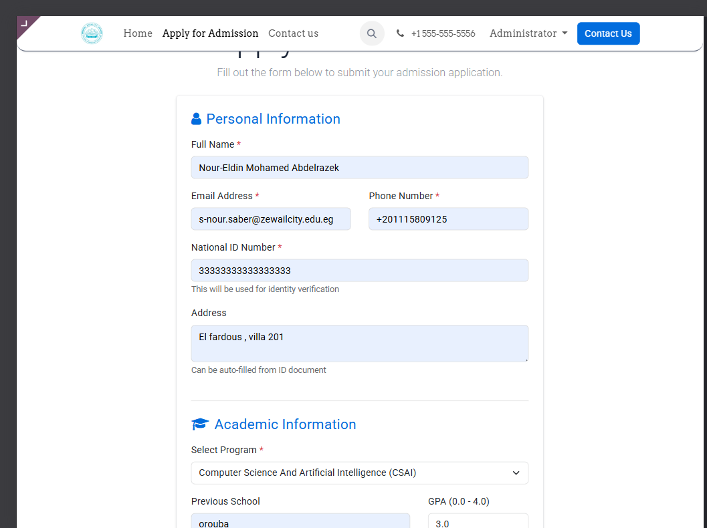
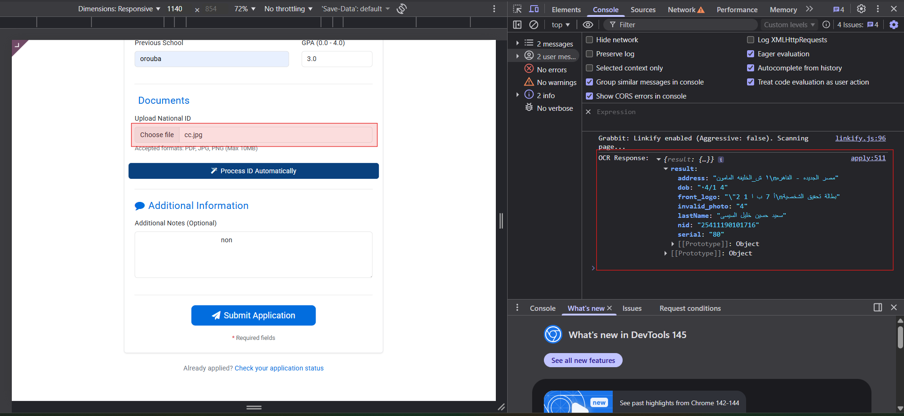
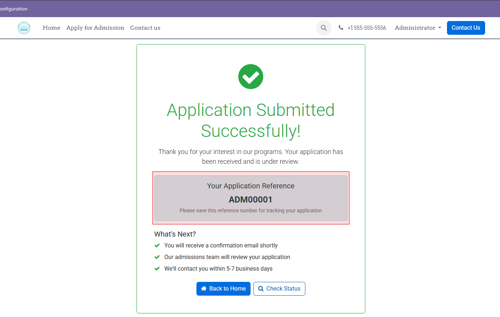
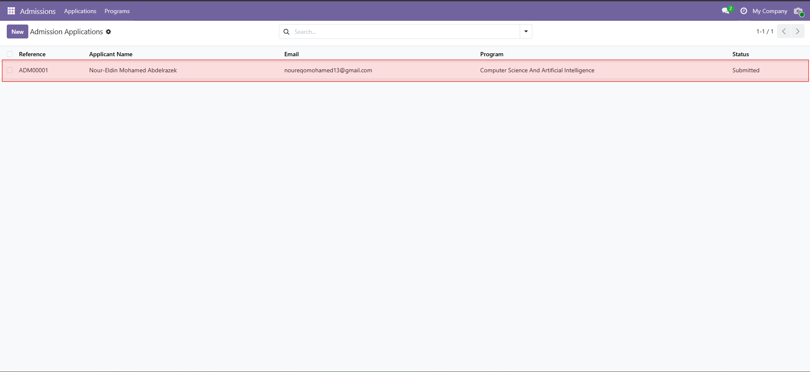
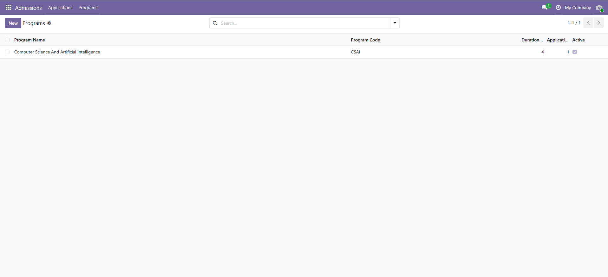
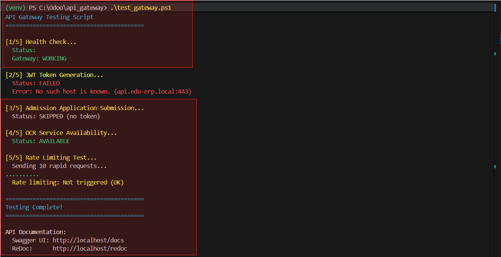

# Implementation and Testing

## Project Overview

The **Educational ERP System** is built on top of Odoo and provides a comprehensive platform for managing academic admissions. The system integrates several components:

- **Odoo ERP** (port 8081) — Core backend handling student data, programs, and admission workflows.
- **Admission Portal** — A public-facing website where prospective students can fill out and submit admission applications, upload documents, and track application status via a reference number.
- **OCR Microservice** (port 5000) — A standalone service that processes uploaded National ID images, extracts personal information (name, address, NID number), and auto-fills form fields.
- **API Gateway** — A Docker-based gateway (FastAPI + Nginx) that provides a unified entry point, JWT authentication, rate limiting, and routing to backend services.

### Key Features

- Online admission form with personal, academic, and document sections.
- OCR-powered auto-fill from National ID card images.
- Auto-generated application reference numbers (e.g. `ADM00001`).
- Application status tracking page for applicants.
- Full admission workflow: Draft → Submitted → Under Review → Accepted / Rejected.
- Role-based access control (Public, Portal, Internal, Manager).
- Backend admin views for managing applications and programs.

---

## Test Evidence

### 1. Admission Form

The public admission portal form with personal information, academic details, and program selection.

---

### 2. OCR Document Processing

Uploading a National ID card image triggers the OCR microservice, which extracts fields (name, address, NID) visible in the browser console response.

---

### 3. OCR with ID Card Preview

The uploaded ID card is displayed as a preview on the form, and the extracted OCR data is shown in the DevTools console.

---

### 4. Application Submitted Successfully

After submission, the applicant sees a confirmation page with their unique reference number (`ADM00001`) and next-step instructions.

---

### 5. Check Application Status

Applicants can look up their application by reference number to see details (name, email, program, date) and current status.

---

### 6. Backend — Admission Applications List

The Odoo backend list view showing all submitted applications with reference, applicant name, email, program, and status.

---

### 7. Backend — Application Detail (Administrator View)

The detailed backend form view of a single admission record, showing related documents, activity log, and message history.

---

### 8. Backend — Programs List

The Odoo backend list view for academic programs showing program name, code, duration, application count, and active status.

---

### 9. Services Health Test (`test_services.ps1`)

Automated script verifying all services are running: OCR Microservice (healthy), Odoo ERP (port 8081), Admission Portal (accessible), and Docker API Gateway (running).

---

### 10. API Gateway Test (`test_gateway.ps1`)

Automated script testing the API Gateway: health check (WORKING), JWT token generation, admission submission, OCR availability (AVAILABLE), and rate limiting.

---

### 11. API Gateway Docker Status

Service overview showing OCR, Odoo, Admission Portal, and Docker API Gateway statuses along with quick access URLs and start commands.

---

## Automated Test Suite

The `admission_portal` module includes **~75 automated test cases** across four files:

| Category | File | Tests | Scope |
|---|---|---|---|
| Integration Tests | `test_controller.py` | 28 | HTTP controller routes, form submission, validation, file upload, status check |
| Model Validation (Admission) | `test_admission_model.py` | 24 | Record creation, email/GPA constraints, state workflow, copy behavior |
| Model Validation (Program) | `test_program_model.py` | 14 | Program CRUD, computed `admission_count`, archiving, One2many relations, ordering |
| Security Tests | `test_security.py` | 32 | CRUD permissions for Public, Portal, Internal, and Manager users on both models |
