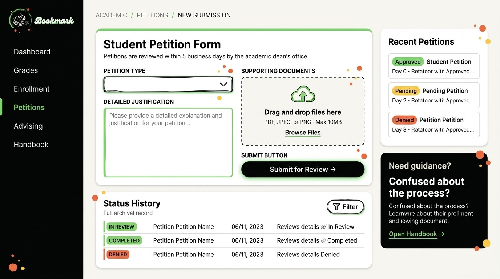
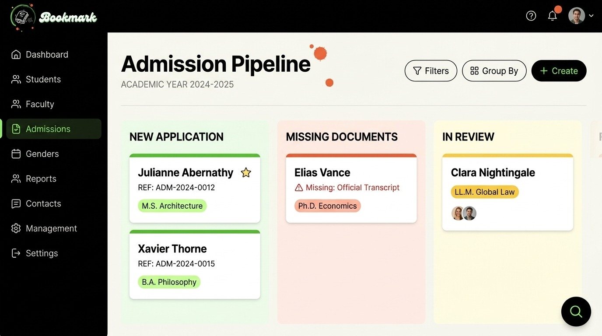
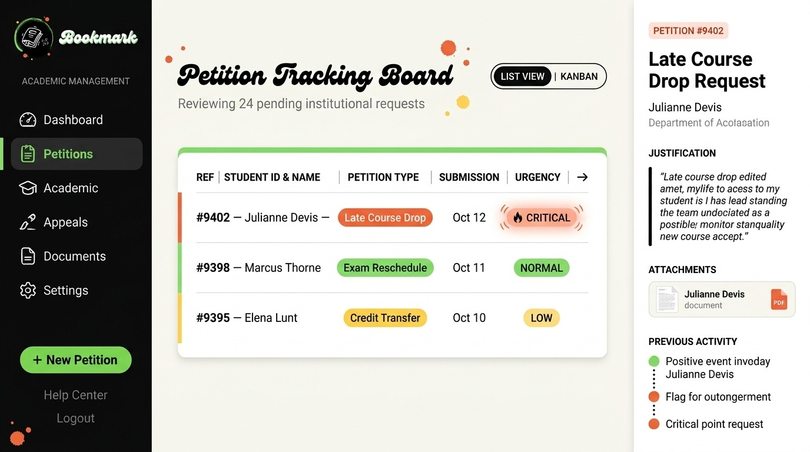
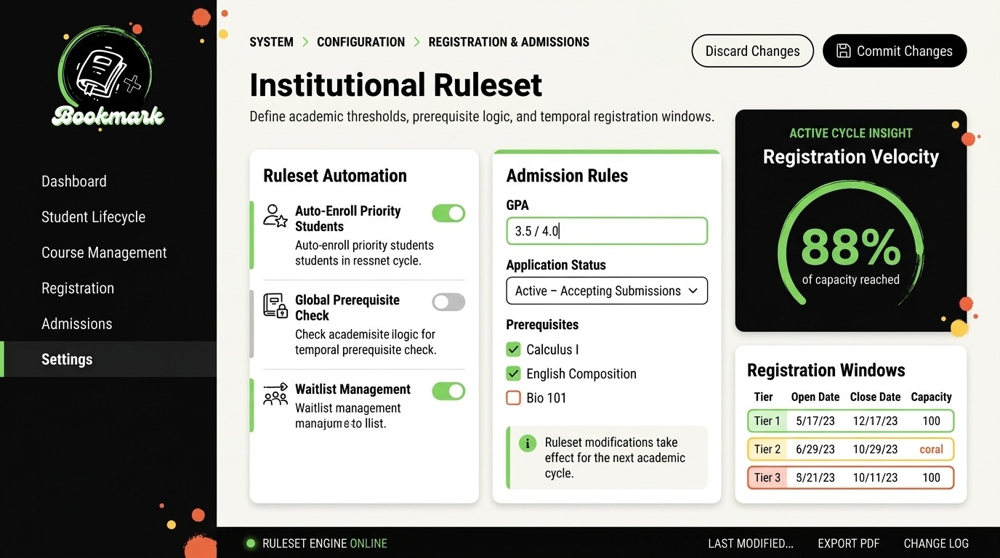
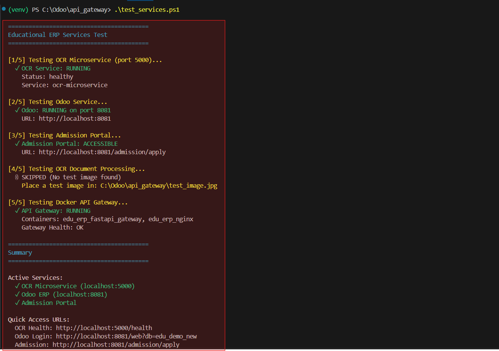

# Bookmark Academic ERP

We built Bookmark ERP because the tools universities currently use — including standard Odoo — weren't designed with students in mind. This project replaces Odoo's default UI with a custom React frontend, routes everything through a FastAPI gateway, and adds three AI services we trained ourselves: a grade predictor, a performance forecaster, and an OCR pipeline for ID documents.

---

## Team Members

| Name | Student ID | Program | Role |
|---|---|---|---|
| Nour Eldin Mohamed | 202201310 | SWD | Team Lead, Backend, API Gateway & Frontend, Infrastructure, Kubernetes & DevOps |
| Ziad Moutaz | 202201252 | DSAI | OCR Service & Integration |
| Raneem Mousa | 202200389 | DSAI | AI/ML Services (Grade Predictor, Student Performance), UI Disigner |
| Ahmed Mohamed | 202202070 | DSAI | AI/ML Services (RAG chatbot, Grade Predictor, Student Performance)|

**Supervisor:** Prof. Dr. Doaa Shawky

**Institution:** Zewail City of Science and Technology — School of Computational Sciences and Artificial Intelligence (CSAI)

---

## Problem Statement

Most university software was built for administrators, not students. At Zewail City, students deal with slow portals, manual registration processes, and no visibility into their own academic standing until it's too late. Staff handle admissions through email and spreadsheets.

We wanted to fix that. Bookmark ERP keeps Odoo as the backend engine (it handles the data model and business rules well) but replaces everything the student or staff member actually sees and interacts with. On top of that, we added AI services that didn't exist anywhere in the existing system: a model that predicts grade outcomes, one that forecasts performance trends with confidence intervals, and an OCR pipeline that reads National ID cards and fills in admission forms automatically.

---

## System Architecture

```
React Frontend (5173)
        │
        ▼
FastAPI API Gateway (8000)  ──► Redis (token blocklist, sessions)
        │
        ├──► Odoo ERP Backend (8081) ──► PostgreSQL (5432)
        │
        ├──► OCR Microservice (5000)          [YOLOv8 + Tesseract, 93% accuracy]
        ├──► Grade Predictor (8000)            [XGBoost + Isotonic Calibration]
        ├──► Student Performance (5002)        [Triple XGBoost + CQR, R²=0.767]
        └──► RAG Academic Chatbot (8001)       [LLM Agent + RabbitMQ + Odoo tools]

Observability: Prometheus (9090) + Grafana (3000)
Orchestration: Kubernetes (kind/minikube) + Docker Compose
```

Full architecture diagram: [Docs/ARC/platform_architecture.drawio.png](Docs/ARC/platform_architecture.drawio.png)

---

## Features

### Student Portal
- Course catalog with prerequisite enforcement and real-time seat counts
- Online course registration with seniority-based tier windows
- Waitlist with automatic FIFO promotion (cron + event-driven)
- Live GPA, per-term transcript, and academic standing
- Petition submission and status tracking
- AI Grade Predictor — predicts grade distribution for enrolled courses
- AI Student Performance — predicts performance trend with 90% confidence intervals

### Admissions
- Online admission form with OCR auto-fill from National ID card images
- Application status tracking via reference number
- Full workflow: Draft → Submitted → Under Review → Accepted / Rejected

### Faculty
- Course roster management
- Petition review and approval
- Grade submission

### Registrar
- Dashboard: enrolled counts, open seats, capacity utilization, active concurrent users
- Course prerequisite management
- Registration tier/window configuration

### Admin
- User management with real role resolution (Student / Faculty / Registrar / Admin)
- Admissions pipeline with stage drag-and-drop
- Institutional ruleset configuration
- Prometheus + Grafana monitoring

### AI Academic Chatbot
- LLM agent with tools: course lookup, grade retrieval, petition status, schedule queries
- Asynchronous job queue via RabbitMQ
- Context-aware responses grounded in live Odoo data

---

## Technologies

| Layer | Technology |
|---|---|
| Frontend | React 18, Vite, React Router, Tailwind CSS, CSS Modules |
| API Gateway | FastAPI, NGINX, SlowAPI (rate limiting), JWT (HS256), Redis |
| Backend ERP | Odoo 19.0, Python 3.12, PostgreSQL 15 |
| AI / ML | XGBoost, scikit-learn, CQR, YOLOv8, EasyOCR, Tesseract, MLflow, DVC |
| LLM | OpenRouter API, RabbitMQ (async jobs) |
| Containerization | Docker, Docker Compose |
| Orchestration | Kubernetes (kind / minikube), Helm-compatible manifests |
| Observability | Prometheus, Grafana, structured JSON logging |
| CI/CD | GitHub Actions (4 workflows: unit, integration, MLflow tracking, testing) |
| Testing | pytest, pytest-cov, FastAPI TestClient, Odoo test runner |

---

## Quick Start

### Prerequisites
- Python 3.12, Node.js 20+, Docker Desktop, Git

### 1. Clone and configure environment
```bash
git clone https://github.com/Noureqo1/BookmarkERP_Odoo_Educational_ERP_System.git
cd BookmarkERP_Odoo_Educational_ERP_System
cp .env.example .env
# Edit .env with your values (JWT_SECRET_KEY, OPENROUTER_API_KEY, etc.)
```

### 2. Install Python dependencies
```bash
python -m venv venv
# Windows:
venv\Scripts\pip install -r api_gateway/fastapi_app/requirements.txt
# Linux/macOS:
venv/bin/pip install -r api_gateway/fastapi_app/requirements.txt
```

### 3. Start the API Gateway and services (Docker)
```bash
cd api_gateway
docker-compose up -d --build
cd ..
```

### 4. Start Odoo backend
```bash
# Windows:
venv\Scripts\python.exe odoo\odoo-bin -c config\odoo.conf
# Linux/macOS:
venv/bin/python odoo/odoo-bin -c config/odoo.conf
```

### 5. Install custom Odoo modules (first run only)
```bash
venv\Scripts\python.exe odoo\odoo-bin -c config\odoo.conf \
  -i edu_mang_notification,edu_mang_academic,edu_mang_waitlist \
  -d edu_demo_new --stop-after-init
```

### 6. Start the React frontend
```bash
cd bookmark-frontend
npm install
npm run dev
# App available at http://localhost:5173
```

---

## Deployment (Kubernetes)

```bash
# Create local cluster
make k8s-create-cluster

# Build and load images
make k8s-build-images
make k8s-load-images

# Deploy all services
make k8s-deploy

# Check status
make k8s-status

# Forward ports
make k8s-port-forward
```

Full Kubernetes documentation: [k8s/README.md](k8s/README.md)

---

## Environment Variables

Copy [`.env.example`](.env.example) to `.env` and fill in:

| Variable | Description |
|---|---|
| `JWT_SECRET_KEY` | Min 32-char secret for JWT signing |
| `OPENROUTER_API_KEY` | API key for the RAG chatbot LLM |
| `POSTGRES_PASSWORD` | PostgreSQL password |
| `REDIS_PASSWORD` | Redis password |
| `ODOO_PASSWORD` | Odoo admin password |

Never commit the `.env` file. See [api_gateway/.env.example](api_gateway/.env.example) for gateway-specific variables.

---

## API Documentation

The FastAPI gateway exposes interactive API docs automatically:

- Swagger UI: `http://localhost:8000/docs`
- ReDoc: `http://localhost:8000/redoc`

Key endpoint groups:

| Prefix | Description |
|---|---|
| `POST /api/v1/auth/login` | JWT login (returns access + refresh tokens) |
| `GET /api/v1/student/dashboard` | Student dashboard with live GPA |
| `GET /api/v1/student/grades` | Per-term transcript |
| `GET /api/v1/registration/courses` | Course catalog with prerequisites |
| `GET /api/v1/registrar/dashboard` | Registrar stats + active concurrent users |
| `GET /api/v1/admin/admissions/pipeline` | Kanban admissions pipeline |
| `POST /api/v1/ocr/process` | National ID OCR extraction |
| `POST /api/v1/chatbot/message` | Academic chatbot (async via RabbitMQ) |

---

## AI/ML Services

### Grade Predictor (port 8000)
Takes a student's transcript and enrolled courses, then estimates the most likely grade outcome (A/B/C/D/F) for each.

We tried three calibration approaches and picked isotonic calibration because it gave us the best trade-off between accuracy and how well the model's confidence scores actually matched reality (ECE). Final numbers: Accuracy = 0.511, ECE = 0.070.

Full comparison: [notebooks/Model_AB_Testing.pdf](notebooks/Model_AB_Testing.pdf)

### Student Performance Predictor (port 5002)
Goes beyond a single grade — this service predicts whether a student's overall performance is trending up or down, and gives a confidence interval around that prediction.

We used three XGBoost models stacked together, then added Conformal Quantile Regression (CQR) to generate honest uncertainty bands instead of point estimates. Results: R² = 0.767, ROC-AUC = 0.952, Brier score = 0.083, coverage = 91%.

### OCR Service (port 5000)
When a student uploads their National ID card during the admission process, this service reads the image and fills in their name, address, and ID number automatically.

EasyOCR was the first thing we tried — it topped out at 71% on Arabic ID cards. We then tested Gemini Vision (89%) before landing on YOLOv8 for field detection combined with Tesseract for text extraction, which got us to 93%. Mistral Vision kicks in as a fallback for cases where confidence is low.

---

## Test Credentials

Database: `edu_demo_new`

| Role | Email | Password |
|---|---|---|
| Admin | `admin@test.com` | `admin123` |
| Student | `student@test.com` | `student123` |
| Officer | `officer@test.com` | `officer123` |

---

## Testing

```bash
# Install test dependencies
make test-install

# Run all tests with coverage
make test-cov

# Run unit tests only
make test-cov-unit

# Run integration tests only
make test-cov-integration

# Run Odoo module tests
make test-admission
```

Test suite: 75+ test cases across unit, integration, and security layers.
CI: 4 GitHub Actions workflows run on every push and PR.

---

## Screenshots

### React Frontend (Student Portal)




### React Frontend (Admin & Registrar)




### Admission Portal (Odoo)


### Backend & Services Health




---

## Usage Guide

### Student
1. Log in at `http://localhost:5173` with student credentials
2. View your dashboard — GPA, enrolled courses, upcoming deadlines
3. Browse the course catalog under **Registration** and add courses (prerequisite check is enforced automatically)
4. Check your grades and transcript under **Grades**
5. Submit a petition (late drop, grade appeal) under **Petitions** and track its status

### Faculty
1. Log in and navigate to **Faculty → My Courses** to view rosters
2. Review and approve/deny student petitions from **Petitions**

### Admin / Registrar
1. Log in and open the **Admin Dashboard** for system-wide stats
2. Manage the admissions pipeline under **Admissions** (Kanban drag-and-drop)
3. Configure registration tier windows and prerequisites under **Settings → Institutional Ruleset**
4. Manage users and roles under **Admin → Users**

### Chatbot
- Click the chatbot icon from any page to open the AI academic advisor
- Ask about course requirements, GPA, petition status, or registration deadlines

---

## Demo

Live screenshots of the running system are in the [Screenshots](#screenshots) section below.

Architecture walkthrough: [Docs/ARC/Bookmark_Academic_ERP_Architecture.md](Docs/ARC/Bookmark_Academic_ERP_Architecture.md)

AI model selection methodology: [notebooks/Model_AB_Testing.pdf](notebooks/Model_AB_Testing.pdf)

---

## Troubleshooting

| Problem | Cause | Fix |
|---|---|---|
| Odoo crashes on Windows startup | Thread monitor timeout | Check `limit_time_real = 99999` is set in `config/odoo.conf` |
| FastAPI returns 401 on all requests | Missing or expired JWT | Re-login or check `JWT_SECRET_KEY` in `.env` matches the gateway |
| OCR returns empty fields | Tesseract not installed | Ensure Docker image built with `tesseract-ocr` layer |
| Frontend shows "Network Error" | Gateway not running | Run `cd api_gateway && docker-compose up -d` |
| Redis connection refused | Redis container stopped | Run `docker-compose restart redis` inside `api_gateway/` |
| Chatbot not responding | RabbitMQ or OpenRouter key missing | Check `OPENROUTER_API_KEY` and `RABBITMQ_*` vars in `.env` |
| Grade Predictor returns 503 | Service not started | Run `make grade-run` to start the service on port 8000 |

For Odoo module issues run:
```bash
venv\Scripts\python.exe odoo\odoo-bin -c config\odoo.conf -u edu_mang_academic -d edu_demo_new --stop-after-init
```

---

## Project Structure

```
.
├── bookmark-frontend/          React 18 SPA
├── api_gateway/                FastAPI gateway + Docker Compose
│   └── fastapi_app/routers/    12 endpoint router modules
├── addons/
│   └── edu_mangment/           Custom Odoo modules
│       ├── edu_mang_notification/
│       ├── edu_mang_academic/
│       └── edu_mang_waitlist/
├── services/
│   ├── ocr/                    OCR microservice (YOLOv8 + Tesseract)
│   ├── grade_predictor_service/ Grade prediction (XGBoost)
│   ├── student_performance_service/ Performance prediction (CQR)
│   └── RAG-Chatbot/            LLM academic advisor
├── k8s/                        Kubernetes manifests
├── Tests/                      pytest test suite
├── Docs/                       Architecture, ADRs, workflows, RBAC
├── notebooks/                  AI model training notebooks + A/B report
└── .github/workflows/          CI/CD pipelines
```

---

## Documentation

- [Architecture Overview](Docs/ARC/Bookmark_Academic_ERP_Architecture.md)
- [Architecture Diagram](Docs/ARC/platform_architecture.drawio.png)
- [Kubernetes Deployment Guide](k8s/README.md)
- [AI Model A/B Testing Report](notebooks/Model_AB_Testing.pdf)
- [User Story Workflows](Docs/Workflows/)
- [Architecture Decision Records](Docs/ADR/)
- [RBAC Design](Docs/RBAC/)

---

## Contact

| Member | Student ID | Email |
|---|---|---|
| Nour Eldin Mohamed | 202201310 | s-nour.saber@zewailcity.edu.eg |
| Ziad Moutaz | 202201252 | s-ziad.sawy@zewailcity.edu.eg |
| Raneem Mousa | 202200389 | s-raneem.adam@zewailcity.edu.eg |
| Ahmed Mohamed | 202202070 | s-ahmed.abopuelela@zewailcity.edu.eg |

**Supervisor:** Prof. Dr. Doaa Shawky — Zewail City of Science and Technology

Repository: [github.com/Noureqo1/BookmarkERP_Odoo_Educational_ERP_System](https://github.com/Noureqo1/BookmarkERP_Odoo_Educational_ERP_System)

---

## License

This project is submitted as a graduation project at Zewail City of Science and Technology — School of Computational Sciences and Artificial Intelligence (CSAI). All rights reserved by the project team.
