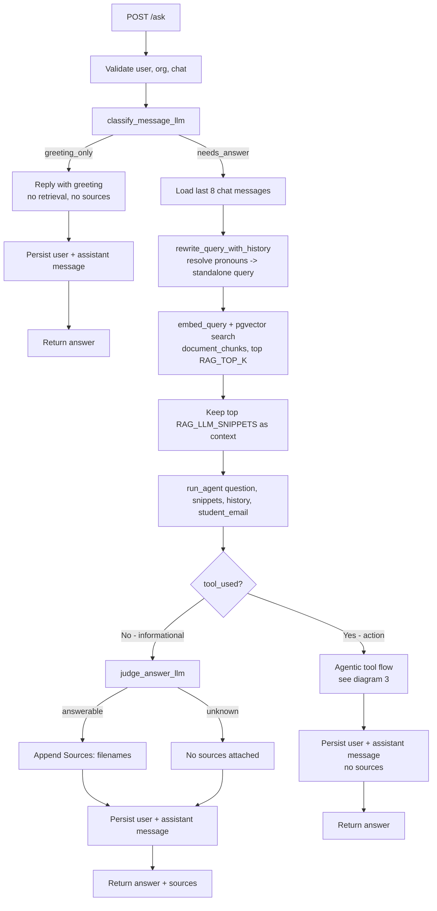
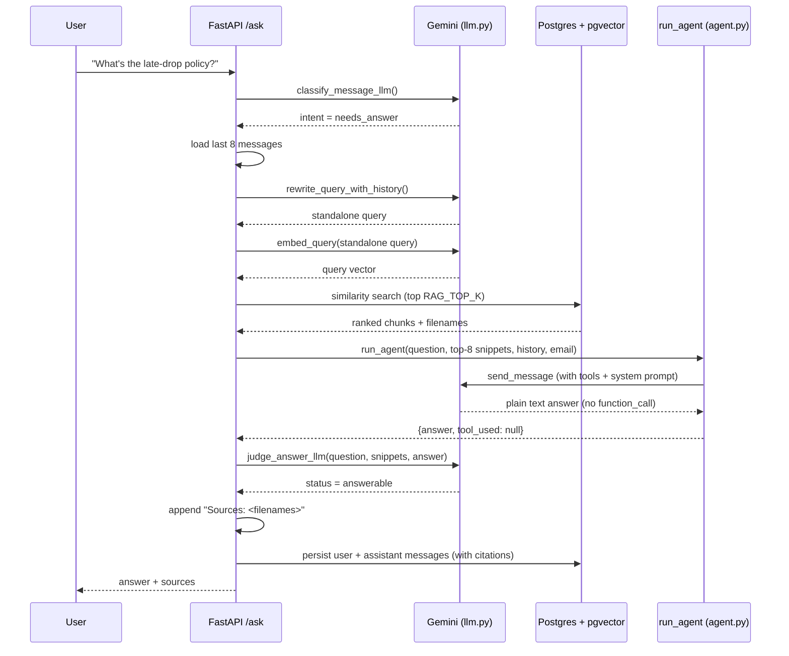
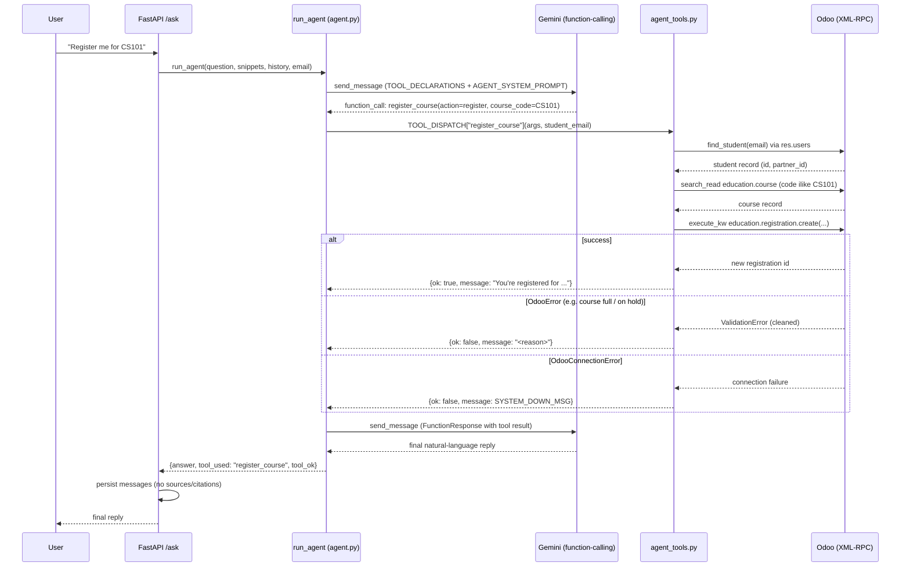
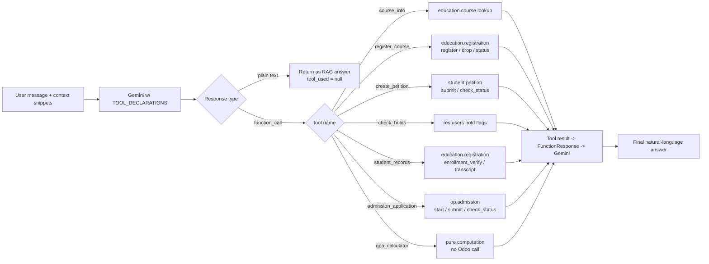

# Chatbot Workflow Diagrams

Companion diagrams for [ARCHITECTURE.md](ARCHITECTURE.md). Rendered with
Mermaid (supported natively in GitHub/VS Code markdown preview).

---

## 1. Overall `/ask` request flow

---

## 2. RAG path (informational questions)

---

## 3. Agentic path (real ERP actions)

---

## 4. Tool decision matrix (inside `run_agent`)

